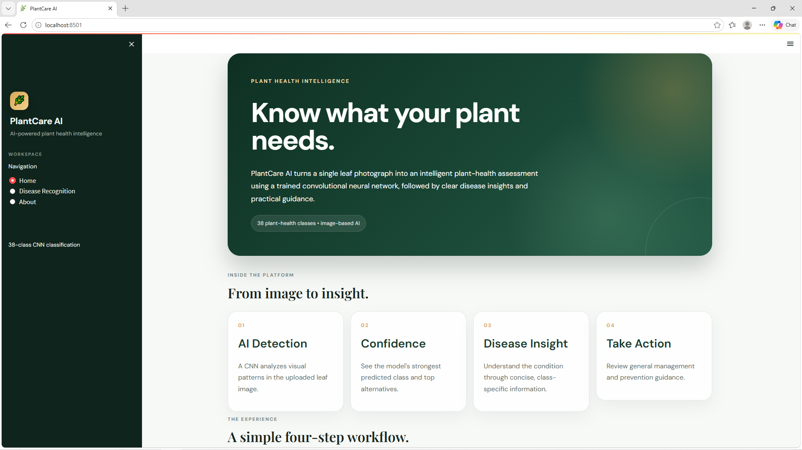
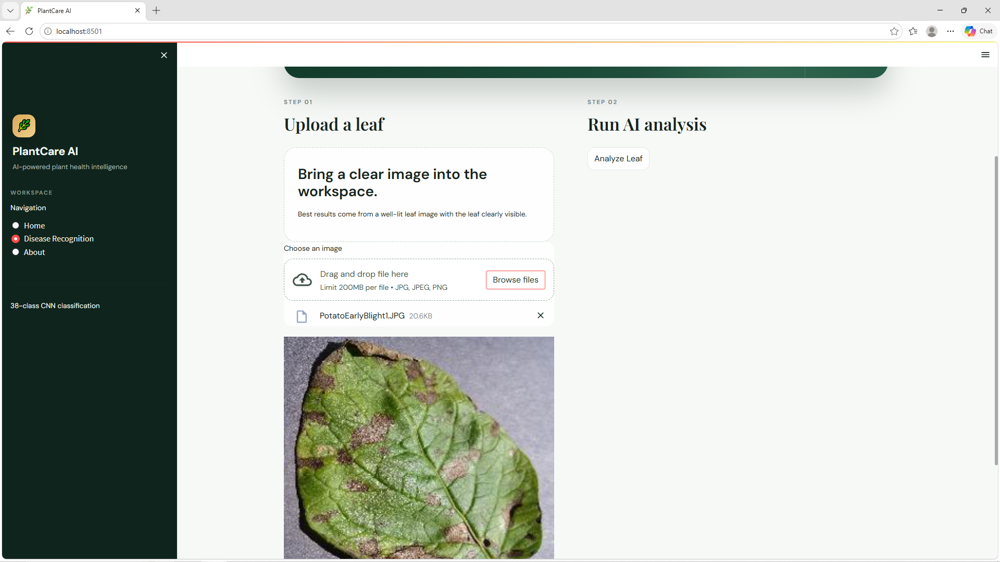
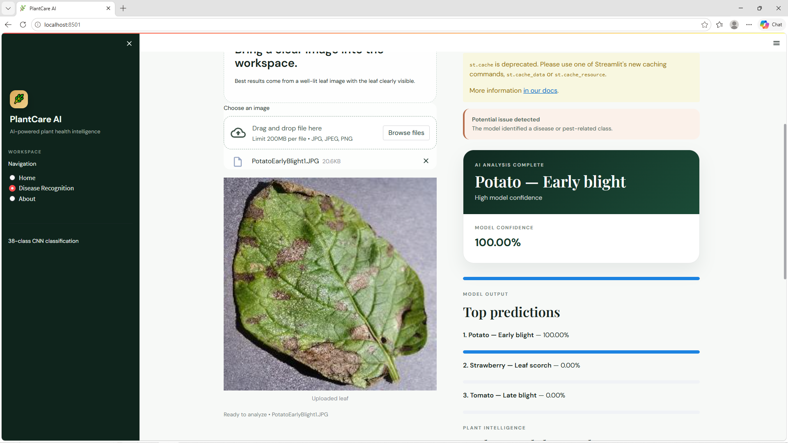
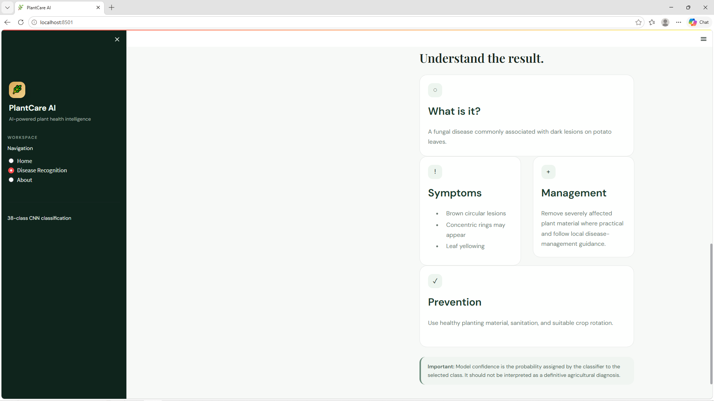

# PlantCare AI

Plant disease detection from leaf images using a Convolutional Neural Network (CNN).
Upload a leaf photo and the app predicts one of **38 healthy / diseased classes** across **14 crops**,
shows the model confidence and top-3 predictions, and gives basic information on symptoms,
management and prevention.

## Results

| Metric | Training | Validation |
|---|---|---|
| Accuracy | 99.05% | 96.30% |
| Macro precision / recall / F1 | - | 0.96 / 0.96 / 0.96 |

- Dataset: 70,295 training and 17,572 validation images, resized to 128 x 128
- Model: 5 convolutional blocks (10 conv layers), dense layer of 1,500 units, 38-way softmax, 7,842,762 parameters
- Weakest class: Tomato early blight (recall 0.79), often confused with Tomato late blight

## Screenshots







## Dataset

Not included in this repository because of its size.
Download it from Kaggle: https://www.kaggle.com/datasets/vipoooool/new-plant-diseases-dataset

To retrain the model, extract the `train`, `valid` and `test` folders next to the notebooks.

## Project files

| File | Purpose |
|---|---|
| `app.py` | Streamlit web application |
| `trained_model.h5` | Trained CNN model (about 94 MB) |
| `Train_plant_disease.ipynb` | Model training and evaluation |
| `testing_plant_disease.ipynb` | Single-image prediction test |
| `requirements.txt` | Python libraries |
| `sample_images/` | Sample leaf images for testing |

## How to run

1. Install Python 3.10 (TensorFlow 2.10 does not support newer Python versions).
2. Create and activate an environment, then install the libraries:
```
pip install -r requirements.txt
```
3. Start the app from the project folder:
```
streamlit run app.py
```
4. Open http://localhost:8501, choose **Disease Recognition**, upload a leaf image and click **Analyze Leaf**.

## Limitations

- The app always returns one of the 38 known classes, even for an image that is not a leaf.
- Model confidence is not a calibrated probability and is not a definitive diagnosis.
- Not tested on real field photographs with cluttered backgrounds.

